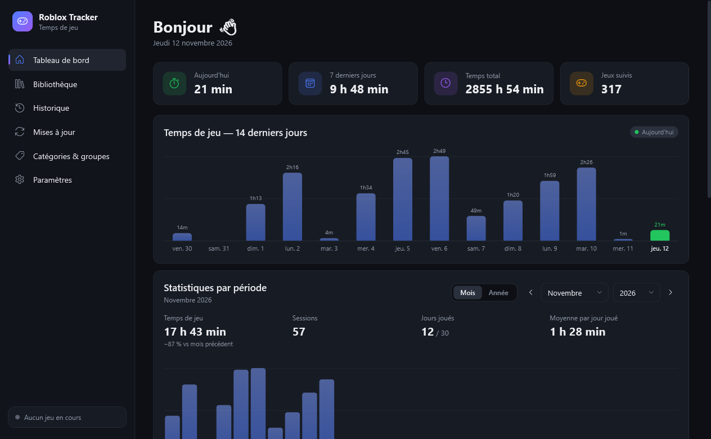
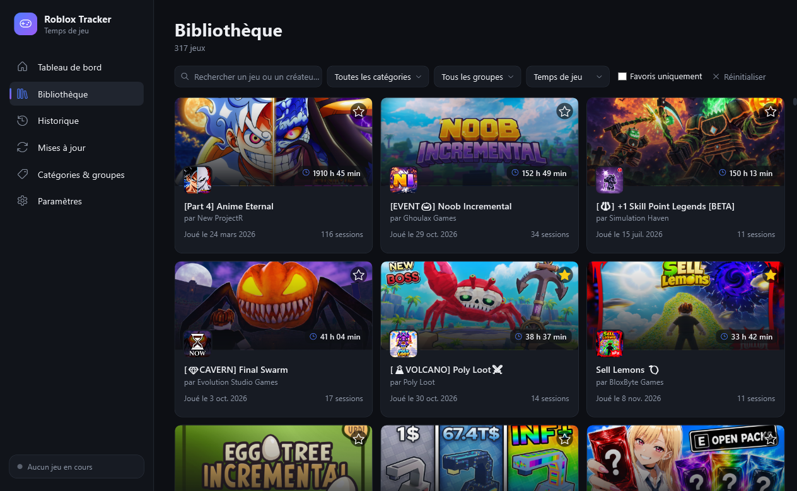
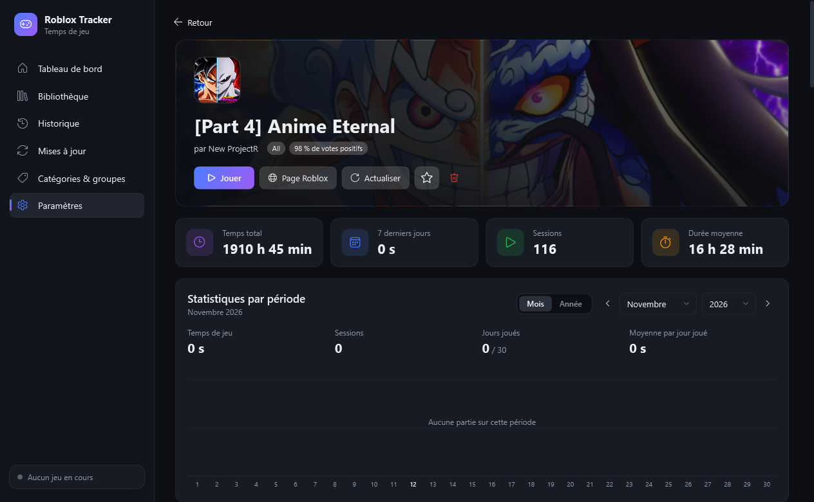
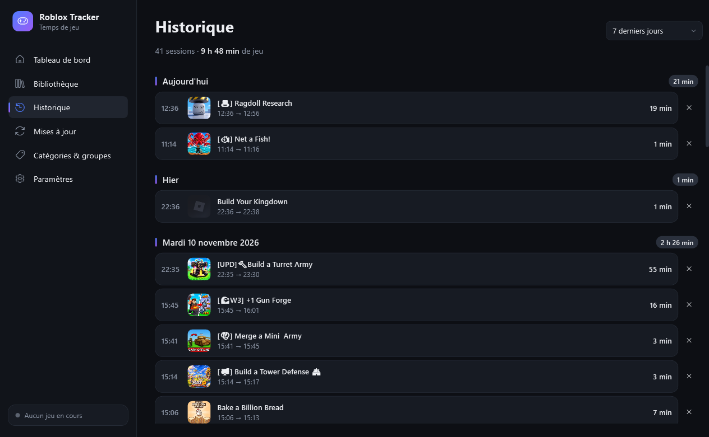
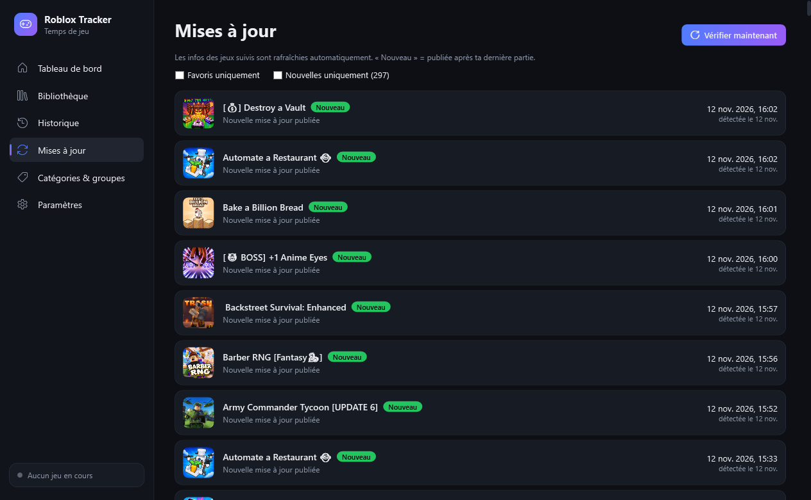
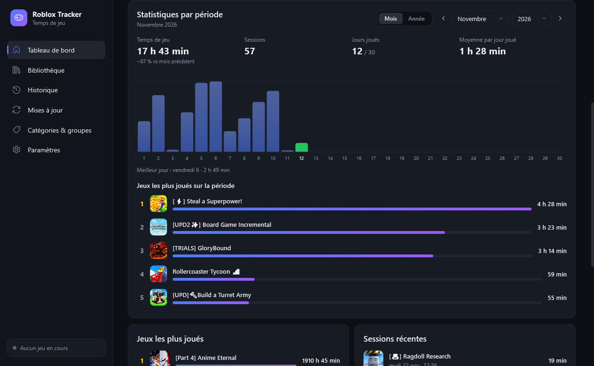
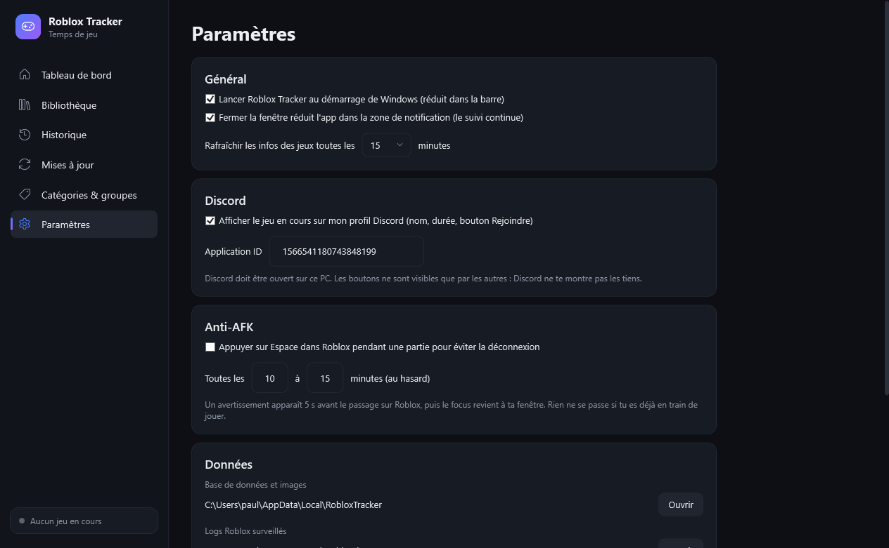

<div align="center">

# 🎮 Roblox Tracker

**Suis ton temps de jeu sur Roblox, jeu par jeu, sans rien toucher à Roblox.**

[](https://github.com/polo5922/RobloxTracker/releases/latest)


**[Voir sur la Marketplace](https://paul-barbaux.dev/marketplace/roblox-tracker)**



</div>

## ✨ Fonctionnalités

- **Suivi automatique** : l'app lit les journaux que Roblox écrit pendant une partie. Elle détecte quand tu rejoins et quand tu quittes une expérience, sans injection et sans modifier Roblox.
- **Tableau de bord** : temps du jour, des 7 derniers jours et total, graphique sur 14 jours et statistiques par mois ou par année.
- **Bibliothèque** : tous tes jeux avec icône, temps joué, favoris et tri.
- **Fiche de jeu** : temps total, nombre de sessions, durée moyenne, statistiques par période, et boutons *Jouer* et *Page Roblox*.
- **Historique** : chaque session avec son début, sa fin et sa durée. Les reconnexions rapprochées sont fusionnées.
- **Mises à jour** : les jeux que tu suis qui ont été mis à jour récemment.
- **Catégories et groupes** : range tes jeux comme tu veux.
- **Discord Rich Presence** : ton profil affiche le jeu en cours, sa durée et les boutons **Rejoindre** et **Voir le jeu**.
- **Anti-AFK configurable** : appuie sur Espace dans Roblox toutes les *X à Y* minutes. Un avertissement apparaît 5 s avant, puis le focus revient à ta fenêtre.
- **Discrète** : réduite dans la zone de notification, elle peut se lancer au démarrage de Windows. Une seule instance tourne à la fois.
- **Import** des sauvegardes `.rtb` de l'ancien tracker.

## 📸 Captures d'écran

| Bibliothèque | Fiche de jeu |
|---|---|
|  |  |
| **Historique** | **Mises à jour** |
|  |  |
| **Statistiques du mois** | **Paramètres** |
|  |  |

## 📥 Installation

1. Télécharge **`RobloxTracker-Setup.msi`** depuis la [dernière release](https://github.com/polo5922/RobloxTracker/releases/latest).
2. Lance-le. L'installation se fait pour ton utilisateur et ne demande pas les droits administrateur.
3. Joue à Roblox : tes parties apparaissent toutes seules.

> Windows SmartScreen peut avertir que l'éditeur est inconnu, car l'installateur n'est pas signé. Clique sur *Informations complémentaires*, puis *Exécuter quand même*.

Pour mettre à jour, installe le nouveau `.msi` par-dessus l'ancien. Tes données sont conservées et sauvegardées automatiquement avant chaque migration.

## 🗂️ Où sont mes données ?

Tout reste sur ton PC, dans `%LOCALAPPDATA%\RobloxTracker` :

| Élément | Contenu |
|---|---|
| `tracker.db` | Base SQLite : jeux, sessions et catégories |
| `settings.json` | Réglages |
| `sauvegardes/` | Sauvegardes automatiques de la base |
| `images/` | Icônes et miniatures en cache |

Les journaux lus sont ceux de Roblox, dans `%LOCALAPPDATA%\Roblox\logs`. Les noms, images et dates de mise à jour des jeux viennent des API publiques de Roblox.

## 💬 Discord Rich Presence

Activée par défaut, il suffit que Discord soit ouvert sur le PC. Tu peux la couper ou changer l'Application ID dans **Paramètres → Discord**.

> Discord ne te montre pas tes propres boutons : ils ne sont visibles que par les autres.

## ⏱️ Anti-AFK

Roblox déconnecte après 20 minutes sans action. Une fois l'anti-AFK activé dans **Paramètres → Anti-AFK** :

| Situation au moment prévu | Ce qui se passe |
|---|---|
| Une autre fenêtre est au premier plan | Un avertissement s'affiche 5 s avant (bouton *Passer*). Ensuite Roblox passe devant, reçoit Espace, puis ta fenêtre reprend le focus. |
| Roblox est devant et tu es inactif | Espace est envoyé directement, sans changer de fenêtre. |
| Roblox est devant et tu joues | Rien ne se passe. |

Choisis un intervalle inférieur à 20 minutes. Si Roblox tourne en administrateur et pas Roblox Tracker, Windows peut bloquer la touche.

> ⚠️ Les règles de Roblox n'autorisent pas forcément ce type d'automatisation : utilise-le en connaissance de cause.

## 🛠️ Compiler depuis les sources

Prérequis : le [SDK .NET 9](https://dotnet.microsoft.com/download/dotnet/9.0). WiX 5 est récupéré automatiquement comme SDK NuGet pour l'installateur.

```powershell
# Lancer l'app
dotnet run --project src/RobloxTracker.App

# Tests
dotnet test

# Exe autonome + installateur MSI (dans publish/ et dist/)
.\build-installer.ps1              # version tirée de la date
.\build-installer.ps1 -Version 1.2.3
```

Captures d'écran des pages, sans lancer le suivi :

```powershell
RobloxTracker.exe --snapshot docs\images
```

### Structure

```
src/RobloxTracker.Core    Logique : lecture des logs, sessions, stats, API Roblox, EF Core SQLite
src/RobloxTracker.App     Interface WPF (MVVM), zone de notification, Discord, anti-AFK
tests/RobloxTracker.Tests Tests xUnit
installer/                Projet WiX de l'installateur MSI
```

---

<sub>Projet non officiel, sans lien avec Roblox Corporation.</sub>
